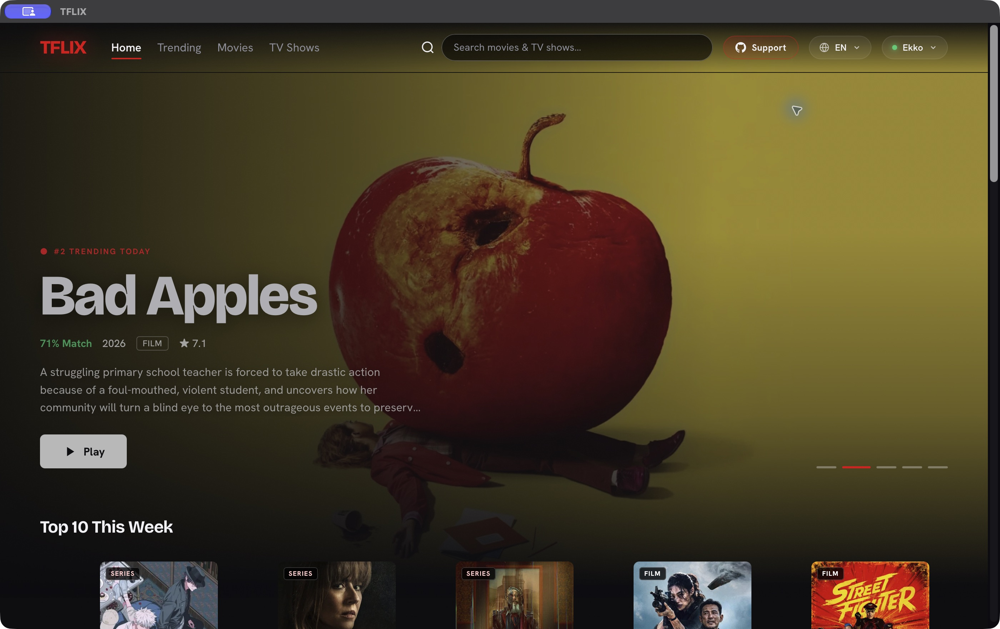
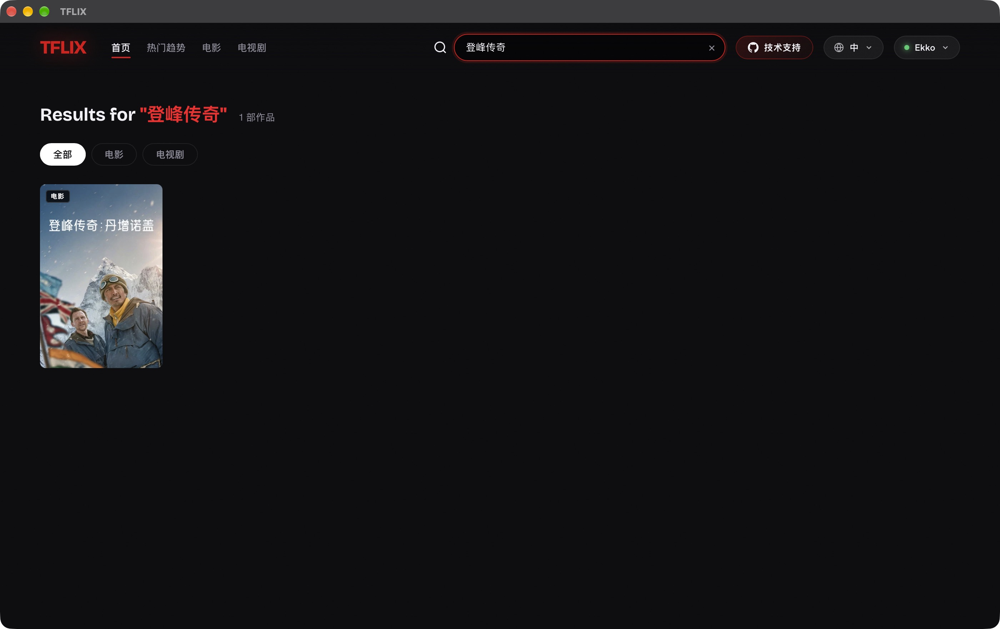
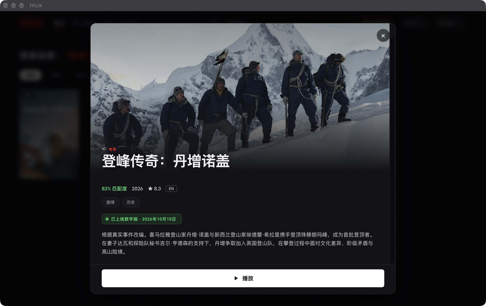
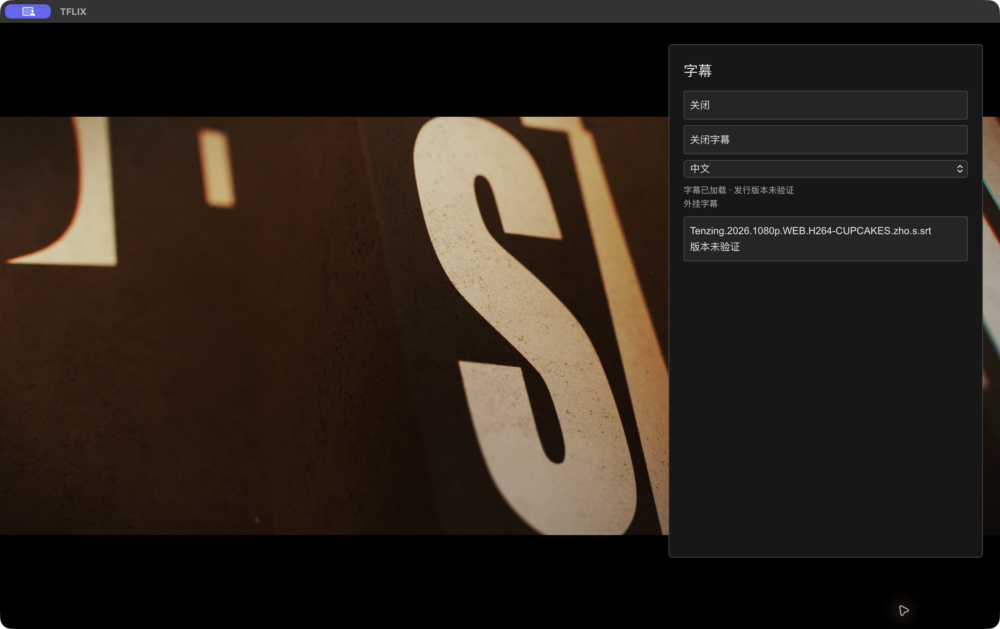
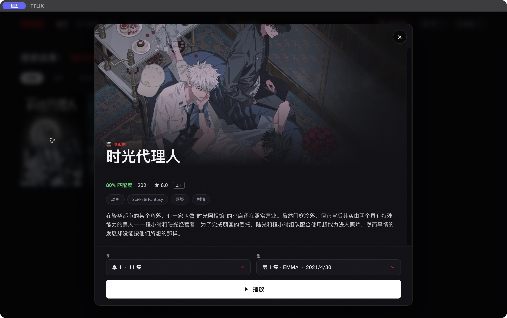
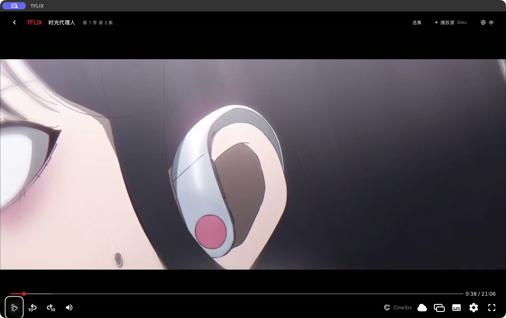
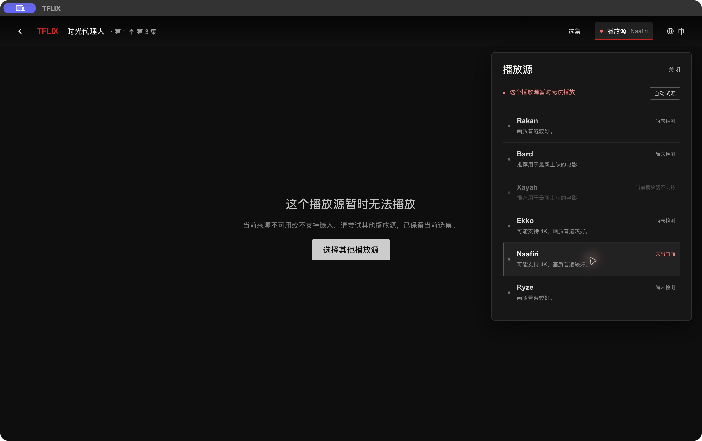
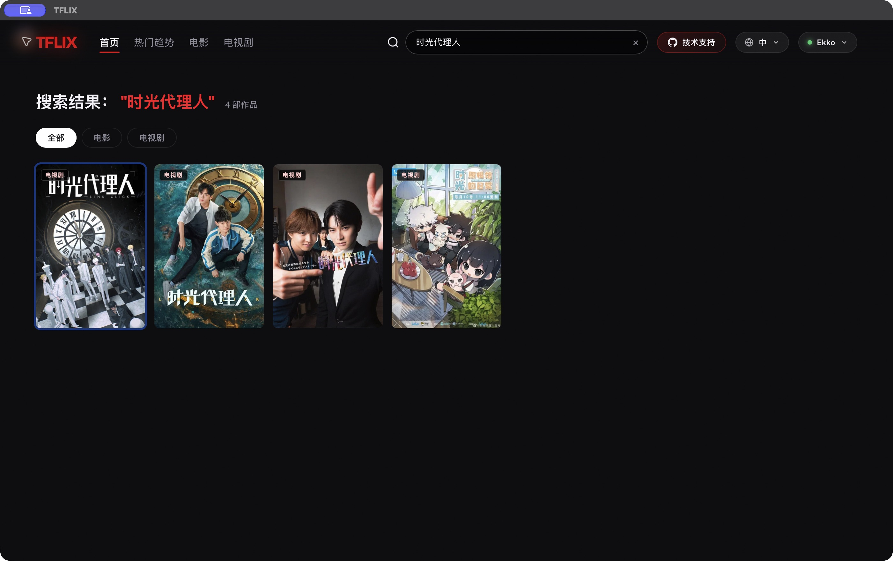

# TFLIX 功能与完整观看路线审查

日期：2026-10-20（上海时间）。目标：从打开客户端到找片、选择内容、真实播放、控制、返回和再次观看，逐项验证状态与失败恢复。当前对象为 macOS 已安装的 `/Applications/TFLIX.app`；不把单元测试或网页推论写成 Android、Windows、Linux 实机通过。

## 判定方式

- **实际通过**：本次运行中观察到界面、媒体时长/时间推进或对应交互结果；截图与可访问结构相互核对。
- **测试通过**：可控请求/媒体事件下的自动化回归，不能代替完整网络/设备实测。
- **有限通过**：部分步骤可用，外部资源、内容版本或未测场景仍有限制。
- **待验证**：尚未完成实际复测，不计为通过。

早期捕获曾出现 `noWindowsAvailable`、界面结构变化而截图仍停在旧状态。这些图不作为详情或菜单审查证据。重启、安装修复包后重新捕获可见状态；保留的有效截图在下文引用。

## 路线与验收记录

| 步骤 | 用户操作与检查细节 | 当前结论 |
|---|---|---|
| 1 | 启动；首页有内容、入口明确；隐藏弹窗不混入键盘/读屏顺序 | 实际通过：中英文首页可见；隐藏弹窗与非当前轮播不再混入操作顺序 |
| 2 | 中英文切换、元数据刷新、菜单关闭和焦点恢复 | 修复搜索标题漏翻译；快速语言切换的旧请求设保护；实际中→英→中切换及英文片名/简介已复测 |
| 3 | 搜索、清空、换词、电影/电视剧过滤、无结果/网络错误 | 实测中文搜索可返回目标；旧请求覆盖与错误冒充空结果已回归验证；网络错误独立提示重试 |
| 4 | 电影详情打开、标题/年份/剧情、播放入口、Escape/Tab | 实际通过；详情可见且背景不进入焦点范围，返回能重开原影片 |
| 5 | 电视剧详情立即打开；季/集加载、禁用、失败重试 | 实际通过；《时光代理人》加载中禁用播放，成功得到第 1 季 11 集，可选第 2 集 |
| 6 | 点击播放；标题、集数、URL、片源一致；等待真实媒体 | 实际通过；电影 Ekko 实际播放；电视剧第 2 集、下一集第 3 集均出画面并有时长/时间推进 |
| 7 | 暂停/继续、快进、进入全屏、Escape 退出 | 实际通过暂停、全屏进入/退出且 0:43 位置保留；未据此推断所有倍速/PiP/硬件快捷键均通过 |
| 8 | 字幕语言、文件加载、状态反馈、退出焦点、画面位置 | 本次完整简中字幕原生加载成功，提示发行版本未验证；不能据此声称与实际音轨逐句内容同步 |
| 9 | 不兼容源反馈、保留选集、换回已验证源、检测结果不丢 | 实测 Naafiri 拒绝沙盒，客户端错误/恢复入口保留第 3 集；最终版已标记不支持并从自动队列排除，首页禁用入口已实测 |
| 10 | 应用自己的选集与下一集；播放器内部选集 | 应用第 2→3 集实际通过；内部选集第 1→2 集实际通过：外层标题/URL 更新，实际媒体变为第 2 集 23:25 |
| 11 | 返回详情、返回搜索；再次观看进度；不同集不串进度 | 实测发现原版从 0:43 返回再播从片头开始，已补同源/时长差不超过 2 秒的进度；实际从第 1 集 0:20 返回再播，媒体确认恢复后推进至 0:43，再暂停 0:55；查询词与结果也恢复一致 |
| 12 | 播放结束、末集、换季、全片稳定性与网络恢复 | 完成清理有事件测试；尚未连续看完整片或穷尽所有边界，不能标全通过 |

## 本次发现并修复

1. **P1：搜索响应乱序。** 连续输入/清空后，旧的三页请求仍可能覆盖当前查询。新增请求序号，输入和清空即失效旧请求，过期结果不渲染。
2. **P1：详情季集请求乱序。** 不同作品、不同季和不同语言共用 DOM，慢响应可能填回旧列表。新增作品/季/语言与请求序号联合保护，缓存按语言区分。
3. **P1：电视剧点击无即时反馈。** 原先等全部季集请求完成才打开详情。现立即展示详情和加载状态，选集未就绪不允许播放。
4. **P1：失败时伪造选集。** 原先信息失败可能生成默认 24 集，用户会选择实际不存在的集数。现明确失败、保留禁用状态和重试按钮。
5. **P1：资料接口故障会拆掉播放器。** 播放与 TMDB 资料独立，原先后者失败会替换整个主界面。现保留播放，资料失败单独提示。请求增加 12 秒上限并检查 HTTP 状态。
6. **P1：同一影片返回再播丢进度。** 新增本地同源进度，按作品/季/集/片源隔离，时长不匹配不恢复；保存最多 100 项、30 天内恢复，结束时清理；不存签名媒体 URL。
7. **P1：第三方内部选集外层不同步。** CineSrc 把选集事件发给中间 iframe，原先没有转发。现只接收确切子窗口与确切 origin 的合法季集消息，外层同步标题、URL 和选集；旧集进度消息不能写进新集。
8. **P2：来源检测结果被清空。** 同一集换源会把刚播放成功的来源重新显示成未检测。现同集保留，换作品/季/集才重置。
9. **P2：确认不兼容的来源仍可选。** 本次电影与电视剧路径再次确认 Naafiri 拒绝沙盒；与 Xayah 一起置为不支持并排除自动队列，保留隔离。首页同样禁用入口并修正无效保存选择。
10. **P2：隐藏/重复控件影响键盘体验。** 关闭弹窗从布局隐藏；详情打开隔离背景并限制 Tab；导航、卡片、语言及片源选择增加按钮语义；非当前轮播设为 inert；焦点激活前检查当前控件是否仍可用。
11. **P2：返回后的查询上下文不一致。** 已观察到结果仍在、输入框却为空，补充 pageshow 恢复当前查询。
12. **P2：字幕面板被播放器样式拉满高度。** 为本地面板明确自适应高度，避免少量选项占满画面；空目录紧凑面板已实际复核。
13. **P2：状态文案与实际操作不符。** 暂停后仍显示正在播放、已找到视频后仍叫停止试源；改为暂停状态与关闭自动换源。

14. **P2：亮色画面中顶部文字对比不足。** 本次内部换集后的白色片头可复现。提高外层控制栏背景遮罩；最终修复包已重新安装并验证启动；旧截图保留作问题证据，不冒充样式修复后的效果。

## 当前证据

### 首页与语言切换（最终版）

### 搜索（修复前混用英文标题）

### 电影详情（修复后）

### 字幕确实加载；内容版本仍未验证

### 电视剧详情的真实季集

### 下一集之后第 3 集实际出画面

### 已确认的失败与恢复入口

### 返回、继续观看与内部选集（最终版）

## 回归验证

`node --test tests/*.test.cjs`：52 项通过。其中本次新增网络乱序、选集加载/失败、详情即时打开、进度隔离/恢复/完成清理与中间 iframe 消息校验。测试不需要新增运行时依赖。

Tauri release app/DMG 构建通过；已安装并执行本报告所列 GUI 复测，签名校验通过。最后的控制栏对比度样式变更重新构建安装，不把它当成一次全片播放复测。

## 明确的剩余限制

- 外挂字幕的发行版本与真实音轨仍没有逐句内容对齐证据。加载/定位通过与内容同步是不同结论。
- 不同片源可能对应不同剪辑，当前有意不把某源进度无条件带到另一源；同源时长相同也不等价于字幕版本验证。
- 目前不是所有片源、所有作品都可播；本次实际证明的是所列影片/剧集与来源。第三方站点可变，不能永久保证全部可用。
- 返回电视剧详情仍保留最初的详情选集；首页尚无“继续观看”列表，不能把同一集的进度恢复说成完整追剧历史。
- 未连续看完完整电影、未做断网再联网的真实系统级测试、未完成 Android TV 遥控器/其他桌面平台实机、读屏软件及最小窗口/所有弹窗组合验证。
- 自然播完后的自动下一集策略没有完整实测；CineSrc 自主自动下一集暂关闭，应用明确的“下一集”入口可用。

没有把上述限制写成通过，也没有用旧会话截图或此前结果替代本次证据。
