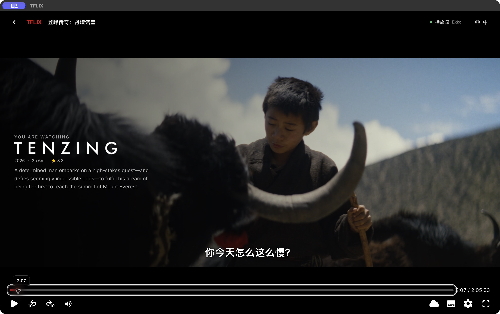
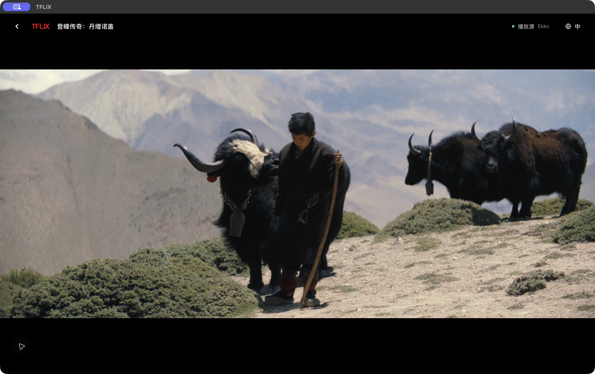
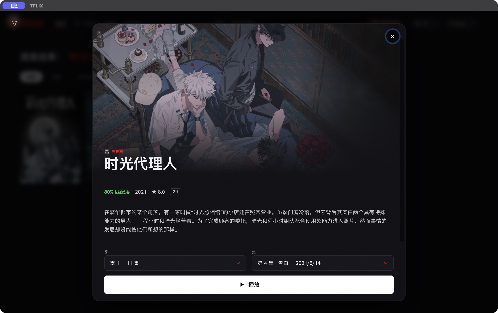
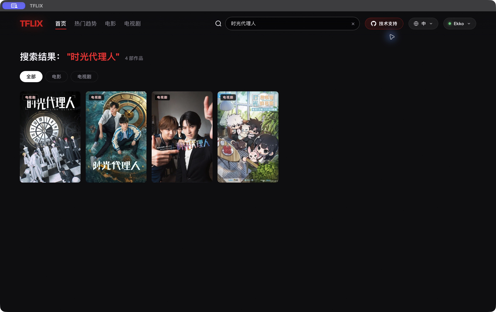

# 播放、字幕与追剧记录后续修复

2026-10-20，本机安装版 `/Applications/TFLIX.app`。本记录只写本次观察，不把之前的测试算成本次通过。

## 已修复

- 首页增加“继续观看”，显示季集、剩余分钟和进度；兼容之前的同源进度记录。最多保留 100 条、30 天内使用。
- 最新实际观看季集与进度单独保存；详情自动选择最新观看的一集。看完后从真实季集数据选择已播后续集，支持跨季；不虚构集数、不推荐已知未播出的下一集。
- 同一 iframe 内部换集后的续播标记按作品/季/集/来源区分，不再只标记整个窗口恢复过一次。
- 实际复现：内部换集后，应用返回按钮调用浏览器历史，只让子框架退回上一集，外层仍显示当前集。改为明确返回详情，恢复搜索词、筛选和离开时的季集。
- 实际复现：从播放器恢复详情后，关闭详情又跳回旧播放器。返回详情使用独立状态，关闭仅清理该状态，不再沿旧播放历史后退。
- 返回时重建“继续观看”卡片后，旧焦点可能已经离开文档；按作品身份寻找新卡片恢复焦点。
- 字幕：本地控制器此前只接管外挂；片源提供的文件仍可能由上游加载并应用其保存偏移。现在片源提供的字幕文件也通过本地生命周期加载，并与当前媒体源绑定；旧源候选不能用于新源。区域语言如 zh-CN 可匹配 zh。
- 有片源随附的对应语言文件时优先使用，不再混入不明发行版外挂。只有作品 ID 的外挂仍明确显示版本未验证。
- 带 `X-TIMESTAMP-MAP` 的分段 WebVTT 不再当作完整外挂文件加载；这类字幕需要媒体 PTS 映射，不能简单忽略该字段。[HLS 标准 §3.5](https://www.rfc-editor.org/rfc/rfc8216#section-3.5)。HLS 原生字幕轨仍由浏览器处理。
- 字幕跳转实测发现：媒体时间已经改变、HLS 解码尚未完成时，旧 activeCues 会暂时残留。现在 seeking/无可用解码帧时清空字幕；seeked/timeupdate 重新刷新，且每条 cue 必须实际覆盖 video.currentTime 才显示。不是给字幕加减秒数。
- 没有外挂目录时不再暗示画面绝无字幕；明确提示可能有画面内嵌字幕，且不能用“关闭字幕”移除这类字幕。

## 实际验证

- 安装后首页“继续观看”读取到已有《时光代理人》，打开默认选中第 2 集，播放后恢复先前 0:24 位置，媒体推进至 0:33。
- 第 2 集视频在本地外挂关闭、中文外挂目录为空时，画面仍出现“照片里的两个人”等中文字幕，证明该源画面自带字幕。截图只能证明文字存在，不能证明实际音轨逐句吻合。
- 内部第 3→4 集后返回，详情正确选第 4 集，未播放完成的选集也不会退回第 1 集。
- 最终修正版本再次实际播放第 3 集（时长 21:06，显示续播提示，时间推进到 0:29）；返回详情选第 3 集，关闭详情后仍停留首页搜索“时光代理人”和原有 4 条结果。

- 《丹增诺盖》最终返回修复版实际播放，时长 2:05:33；完整中文外挂原生解析成功，快进到 2:07 显示“你今天怎么这么慢？”，对应文件原始 2:07.377–2:09.755。继续跳转时观察到了上述旧字幕短暂残留问题，追加修复及专门回归。
- 追加修复后的安装版再次打开《丹增诺盖》：字幕面板显示“字幕已加载 · 发行版本未验证”；定位到媒体 2:07 时无障碍树返回当前 cue“你今天怎么这么慢？”，跳到 1:04:09 时返回对应 cue“我认输 你赢了”，再跳到 2:12 时旧 cue 不再保留。字幕显示严格跟随媒体 `currentTime`，没有固定秒数补偿。

## 回归与构建

68 项自动化测试通过，包含字幕随源绑定/换源拒绝、原始时间保留、分段时间映射拒绝、旧进度迁移、完成后下一集/跨季、内部换集独立续播、字幕 seek 后旧 cue 清理，以及返回和关闭详情不再穿越 iframe 历史。内联脚本和注入脚本语法校验通过，`git diff --check` 通过。

Tauri release app/DMG 构建成功，更新安装后 `codesign --verify --deep --strict` 通过。

## 尚未完成的验收

不能仅凭字幕出现或单元测试宣布音轨同步问题全部解决。当前可用界面工具提供画面和控件状态，没有实际音频回传；尚未对所选外挂文件做真实音轨的头/中/尾台词对齐验证。片源随附字幕表示来源绑定，并不自动等于内容同步已验证。错误剪辑版本仍需同版字幕或真实台词锚点，不能凭空生成可靠时间修正。

跨季自动选择已有回归测试，未在实机连续播放至整季结尾；不同片源时长/剪辑不同，进度不会无条件跨源套用。
